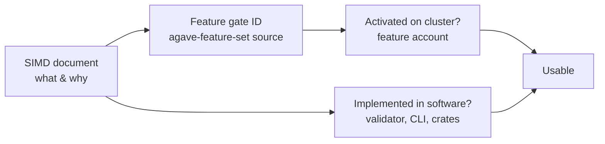
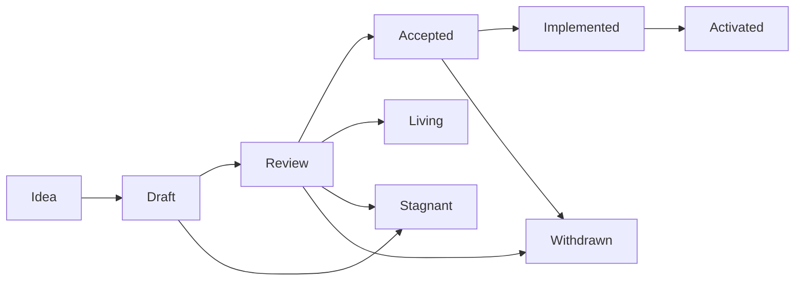

# Reading SIMDs and checking whether a feature is live

How to go from "SIMD-0385 says..." to "this works on devnet with this software". All examples
were run on 2026-11-02.

What was actually checked while setting up `pinocchio.md`: **feature gates** (on-chain feature
accounts plus the `agave-feature-set` crate source), plus the text of SIMD-0385. A SIMD only
describes a change. Whether you can use it depends on three other things (section 4).



## 1. Where SIMDs live

- Repo: <https://github.com/solana-foundation/solana-improvement-documents>
- One file per proposal: `proposals/<NNNN>-<slug>.md`, e.g. `proposals/0385-transaction-v1.md`.
- Ideas and discussion: the repo's Discussions → Ideas. Debates happen in the proposal's PR.

```sh
# list all proposal files
curl -s "https://api.github.com/repos/solana-foundation/solana-improvement-documents/contents/proposals" \
  | python3 -c "import json,sys;[print(x['name']) for x in json.load(sys.stdin)]"
# read one
curl -s https://raw.githubusercontent.com/solana-foundation/solana-improvement-documents/main/proposals/0385-transaction-v1.md
```

A SIMD number that isn't in `proposals/` is still an open PR or was never merged. Search the
repo's pull requests for it.

## 2. Anatomy of a SIMD

Every file starts with YAML front matter:

```yaml
simd: '0385'
title: Transaction V1 Format
authors: [jacobcreech, apfitzge]
category: Standard        # Standard | Meta | Advisory
type: Core                # for Standard: Core (consensus/validator) | Networking | Interfaces (RPC API)
status: Activated
created: 2025-10-24
feature: (fill in with feature key and github tracking issues once accepted)
```

**`status`**: the lifecycle from SIMD-0001:



`Accepted` means "agreed". `Implemented` means "code exists, gate not flipped". `Activated`
means the feature gate is on (on at least some clusters; check each one, section 3).

**`feature`**: the gate's public key. **Don't trust it blindly.** Checked:

| SIMD | `feature:` in front matter | Real gate in Agave (`agave-feature-set` 4.4.0) |
|---|---|---|
| 0385 Transaction v1 | not filled in | `txv1aq4pp281K9um3tnPgkfX8UqtFT6wcVW3hNezGLL` |
| 0178 Static syscalls | `BUwGLeF3...` (account doesn't exist on devnet, not in Agave) | `5cC3foj77CWun58pC51ebHFUWavHWKarWyR5UUik7dnC` (one gate for SBPF v3) |
| 0189 Stricter ELF headers | `GJav1vwg...` (account doesn't exist on devnet, not in Agave) | same `5cC3foj...` |
| 0377 eBPF ISA compatibility | not filled in | same `5cC3foj...` |
| 0173 / 0174 SBPF v2 | `F6UVKh1u...` | `F6UVKh1u...` (matches) |

The source of truth is the validator code (section 3.1).

**Body sections**, in the order to read them:

| Section | Read it for |
|---|---|
| Summary / Motivation | Is this the thing I care about? |
| New Terminology | Names used in the code and errors |
| **Detailed Design** | Exact behavior, byte layouts, defaults. This is the section the code implements |
| Constraints / limits tables | Numbers you'll hit (sizes, counts) |
| Impact | What breaks or changes for developers |
| Security Considerations | Edge cases |
| Alternatives / Backwards compatibility | Why it isn't done another way; what still works |

## 3. From SIMD to "is it live?"

### 3.1 Find the gate ID in Agave's source

Every runtime-changing SIMD is behind a feature gate in the crate `agave-feature-set`.
`FEATURE_NAMES` there maps each ID to a description that names the SIMD:

```sh
# the crate source is in your registry once any project pulled it (litesvm does)
F=$(ls -d ~/.cargo/registry/src/*/agave-feature-set-4.4.0)/src/lib.rs
grep -n "SIMD-0385" $F
#   2601: (enable_tx_v1::id(), "SIMD-0385: Transaction V1"),
grep -n -A1 "pub mod enable_tx_v1 " $F
#   solana_pubkey::declare_id!("txv1aq4pp281K9um3tnPgkfX8UqtFT6wcVW3hNezGLL");
grep -n "SIMD-0178" $F
#   "SIMD-0178, SIMD-0189 and SIMD-0377: Enable deployment and execution of SBPFv3 ..."
```

No local copy: `cargo new /tmp/p && cd /tmp/p && cargo add agave-feature-set && cargo fetch`, or
browse `feature-set/src/lib.rs` in <https://github.com/anza-xyz/agave>.

If the SIMD isn't mentioned in `FEATURE_NAMES` of the newest `agave-feature-set`, it is either
not implemented yet, or was activated long ago and its gate code was cleaned up.

### 3.2 Check activation on each cluster

A feature account is owned by `Feature111111111111111111111111111111111111`. Its data is
`[1 byte: Some/None][8 bytes: activation slot, u64 LE]`.

- Account missing (`"value": null`): never activated, or the ID is wrong.
- First byte `0`: queued, not active yet.
- First byte `1`: active since that slot.

```sh
feature() {  # usage: feature <cluster> <id>...   cluster = devnet | testnet | mainnet-beta
  local net=$1; shift
  for f in "$@"; do
    printf "%-13s %s: " "$net" "$f"
    curl -s "https://api.$net.solana.com" -X POST -H "Content-Type: application/json" \
      -d "{\"jsonrpc\":\"2.0\",\"id\":1,\"method\":\"getAccountInfo\",\"params\":[\"$f\",{\"encoding\":\"base64\"}]}" \
    | python3 -c "import json,sys,base64,struct
v=json.load(sys.stdin)['result']['value']
if v is None: print('missing (not activated / wrong id)')
else:
  b=base64.b64decode(v['data'][0]); print('activated at slot %d'%struct.unpack('<Q',b[1:9])[0] if b[0]==1 else 'pending')"
  done
}
feature devnet       txv1aq4pp281K9um3tnPgkfX8UqtFT6wcVW3hNezGLL 5cC3foj77CWun58pC51ebHFUWavHWKarWyR5UUik7dnC
feature mainnet-beta txv1aq4pp281K9um3tnPgkfX8UqtFT6wcVW3hNezGLL 5cC3foj77CWun58pC51ebHFUWavHWKarWyR5UUik7dnC
```

Results on 2026-11-02:

| Gate | devnet | testnet | mainnet |
|---|---|---|---|
| `txv1aq4pp...` (SIMD-0385) | slot 492,480,000 | slot 437,276,256 | slot 447,120,000 |
| `5cC3foj...` (SBPF v3) | slot 461,808,000 | slot 406,604,256 | slot 428,976,000 |
| `F6UVKh1u...` (SBPF v2) | slot 396,576,000 | slot 346,124,256 | slot 356,400,000 |

Via the CLI (only reliable if the CLI is new enough to know the ID):

```sh
solana feature status -u devnet txv1aq4pp281K9um3tnPgkfX8UqtFT6wcVW3hNezGLL
#   4.4.0: active since epoch 1140
#   4.1.2: Error: Unknown feature   (and its full list shows an old id, txv1hPU7..., as inactive)
```

Use the raw `getAccountInfo` check whenever the CLI and the cluster may differ in version.

### 3.3 Check the software that has to implement it

An active gate is useless if your tools predate the final spec:

| Layer | How to check | Example |
|---|---|---|
| Cluster nodes | `curl -s https://api.devnet.solana.com -X POST -H "Content-Type: application/json" -d '{"jsonrpc":"2.0","id":1,"method":"getVersion"}'` | devnet `4.4.0-beta.1`, mainnet `4.3.2` |
| Local validator / CLI | `solana --version` | 4.1.2 rejected final v1, 4.4.0 accepted it |
| Client crates | Does the type exist? `grep -rn "pub mod v1" ~/.cargo/registry/src/*/solana-message-*/src/versions/` | `v1::Message` in solana-message 4.1+ |
| Test harness | Can it load / run it? | litesvm 0.10 can't load SBPF v3; 0.18.1 can, and runs v1 transactions |
| Implementation PRs | `https://api.github.com/search/issues?q=repo:anza-xyz/agave+SIMD-0385` | `#11238`, `#11239` (v1 layout in TransactionView), `#15270` (remove txv1 gate checks) |

A PR that removes a feature's gate checks means the feature is fully live and the gate is being
cleaned up. After that, the description can disappear from newer `FEATURE_NAMES`.

Activation schedules are kept on the Agave wiki:
<https://github.com/anza-xyz/agave/wiki/Feature-Gate-Tracker-Schedule>.

## 4. Worked example: SIMD-0385 (transaction v1) → code

Reading the Detailed Design produced every v1 rule used in `pinocchio.md` and
`anchor-vault/client`:

| SIMD-0385 says | Consequence in code |
|---|---|
| `VersionByte` MUST be `129` | Old parsers that don't know 129 fail. Hence `max_supported_transaction_version: Some(1)` on reads, and CLI 4.1.2's "version (1) is not supported" |
| Size limit 4096 (was 1232); ≤ 64 accounts, ≤ 64 instructions, ≤ 12 signatures | Bigger transactions, same account cap |
| `Addresses` must contain **no duplicates** (sanitization failure) | `v1::Message::try_compile*` dedups keys for you. A hand-built message must not repeat an address |
| No address lookup tables | Use v0 if you need ALTs |
| `TransactionConfigMask` bits: [0,1] priority fee (u64), [2] CU limit, [3] loaded-accounts data size, [4] heap size | `v1::TransactionConfig::empty().with_priority_fee(..).with_compute_unit_limit(..).with_loaded_accounts_data_size_limit(..)` |
| Priority fee = "**total lamports** for transaction" | `with_priority_fee(1_000)` adds 1,000 lamports in total, not per CU. Observed fee: 5,000 (signature) + 1,000 |
| Bit not set → CU limit **0**, loaded-accounts limit **0** (was 64 MiB) | Always set both, or the transaction can't run. `v1_compute_limit_is_enforced` shows the limit is applied |
| Heap default 32 KiB; if set, a multiple of 1 KiB in [32, 256] KiB | Leave unset unless you need more heap |
| ComputeBudget instructions are **ignored** for configuration in v1 (they still cost CU) | Don't add `ComputeBudgetInstruction::*` to v1 messages |

## 5. SIMDs behind this repo's setup

| SIMD | Title | Status (front matter) | Gate | Live? |
|---|---|---|---|---|
| 0173 | SBPF instruction encoding improvements | Activated | `F6UVKh1u...` (SBPF v2) | devnet, testnet, mainnet |
| 0174 | SBPF arithmetics improvements | Activated | `F6UVKh1u...` (SBPF v2) | devnet, testnet, mainnet |
| 0178 | SBPF static syscalls | Activated | `5cC3foj...` (SBPF v3) | devnet, testnet, mainnet |
| 0189 | SBPF stricter ELF headers | Activated | `5cC3foj...` (SBPF v3) | devnet, testnet, mainnet |
| 0377 | eBPF ISA compatibility | Activated | `5cC3foj...` (SBPF v3) | devnet, testnet, mainnet |
| 0385 | Transaction V1 format | Activated | `txv1aq4pp...` | devnet, testnet, mainnet |
| 0500 | Disable deployment of SBPF v0, v1, v2 | Idea | `B8JJXCy5...` | not active (old-arch deploys still allowed) |

Correction to `real.md` section 8: it lists SIMD-0179 for SBPF v3. Agave 4.4.0 describes the
v3 gate as "SIMD-0178, SIMD-0189 and SIMD-0377", and there is no 0179 file in `proposals/`.

## 6. Checklist for any new SIMD

1. Read the front matter (`status`, `type`). Then read **Detailed Design** fully, including the
   defaults and the "MUST" lines.
2. Find the gate: `grep -n "SIMD-<NNNN>"` in the newest `agave-feature-set` `src/lib.rs`.
   Ignore the front-matter `feature:` if it doesn't match.
3. Check the gate on every cluster you target with `getAccountInfo` (section 3.2), not only
   with `solana feature status`.
4. Check the software: cluster `getVersion`, your CLI/validator version, the client crate
   types, the test harness.
5. Write a test that exercises the SIMD's main rule (like `v1_compute_limit_is_enforced`), so
   a tool that silently lacks support fails loudly.
